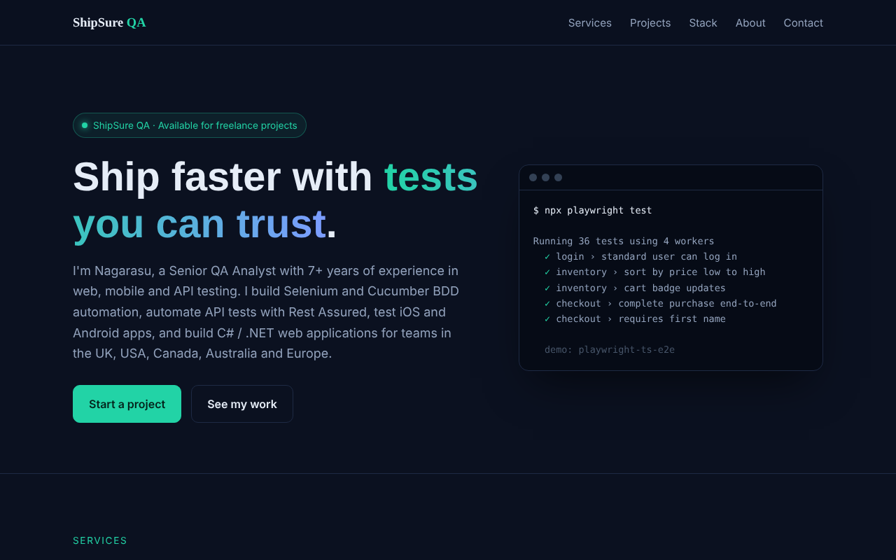

# ShipSure QA · Portfolio Website

[](https://github.com/ShipSureQA/ShipSureQA.github.io/actions/workflows/site-tests.yml)

**Live:** https://shipsureqa.github.io



Portfolio site for **ShipSure QA** (Nagarasu P): QA automation, API testing and C# / .NET development.

## Tech
- Single static page: HTML, CSS, vanilla JS. No build step, no framework, fast to load
- Hosted free on GitHub Pages
- Contact form via [Web3Forms](https://web3forms.com) (free tier, no backend)
- SEO: meta description, Open Graph image, sitemap, robots.txt, JSON-LD Person schema
- Accessible: semantic landmarks, skip link, focus styles, reduced-motion support

## Tested like a product
The site is covered by **14 Playwright tests × 2 devices (desktop + Pixel 7)**, run on every push:

| Area | What's checked |
|---|---|
| Basics | title & social meta, favicon, no JS errors, no horizontal overflow, custom 404 |
| Navigation | no empty `#` links, every anchor has a target, external links are https + `noopener`, project links go to real repos, mobile menu |
| Contact form | required-field & email validation, success flow, server error, network failure, double-submit protection |
| Accessibility | axe-core: zero serious/critical WCAG 2.1 AA violations |

```bash
npm ci
npx playwright install chromium
npm test
```

## Configuration
| Setting | Where |
|---|---|
| Web3Forms access key | `index.html` → `input[name="access_key"]` (public key by design; it only allows sending to the owner's inbox) |
| Platform profile links | `index.html` → `#contact .platforms` |

## Known limitations
- Contact form stays inactive until a Web3Forms key is added. Until then, visitors are pointed to LinkedIn instead of seeing an error.
